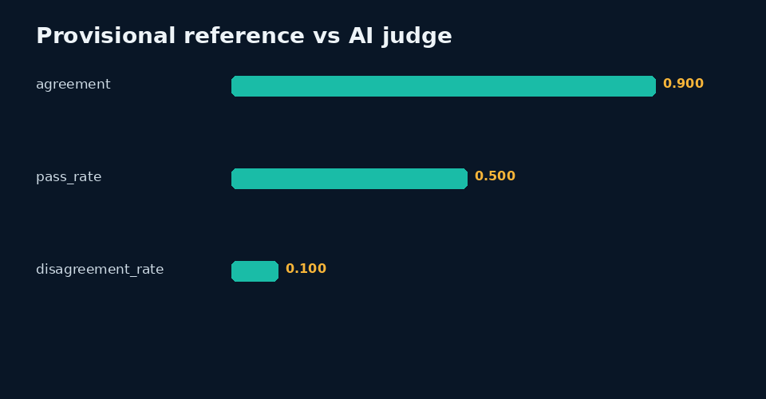

# LLM Pairwise Evaluation

> Independent portfolio practice by Sinshad PS. AI assistance was used during development. See the data card for exactly which records are synthetic.

## Why I made it

I made this small project to practise comparing two answers using the same written criteria instead of choosing whichever one sounds more polished. It keeps the rubric, provisional decisions and cases that deserve another look together. The example pairs and reference labels are synthetic, and AI tools helped me build the workflow. This is a practice exercise, not an evaluation job or a claim of human-verified accuracy.

## Dataset
See [`data/DATA_CARD.md`](data/DATA_CARD.md). All records are UTF-8 and available as JSONL and CSV.

## Evaluation framework
Compare the held-back provisional author preference with a separate AI scoring pass preference. Compute a three-class confusion matrix, agreement, category slices, score means, threshold sensitivity, and response-level pass rules.

## Scoring
Weighted score = 0.4×accuracy + 0.3×instruction following + 0.2×helpfulness + 0.1×clarity. Pass requires weighted score ≥4, accuracy ≥4, and instruction following ≥4.

## Tools
Python standard library and Pillow. Inputs and outputs remain local; no network service is required.

## Implementation
- `src/analyze.py` runs this project independently.
- Root `analysis.py --project llm` contains reusable metric and plotting logic.
- `notebooks/analysis.ipynb` contains executable code and captured output from the real metrics file.
- `results/review_queue.csv` makes disagreements, failures, escalations, or abstentions visible.
- `qa/worked-cases.md` connects evidence, rubric, QC, and decisions.

## Results
**AI-reference agreement: 90.0%**

The complete machine-readable output is [`results/metrics.json`](results/metrics.json), with interpretation in [`results/analysis.md`](results/analysis.md).

## What the result means

The reported 45/50 agreement is agreement with provisional AI-authored preferences—not human accuracy or evidence that a real model performs at 90%. The model family/version is not known, so I do not claim independent model-family validation.

## Limitations
Neither the provisional author preference nor AI judge is human gold. Both calls use the Strawberry fast tier; underlying model identity/version and temperature were not supplied. Independence of model family is not established. Agreement is not model accuracy or human kappa.

## Future work
Run blinded qualified human review, adjudicate disagreements, document reviewer eligibility, test robustness under distribution shift, and revise rules only on calibration data before re-evaluating holdout data.

## Reproduction
From repository root:

`python analysis.py --project llm`

or:

`python 01-LLM-Evaluation/src/analyze.py`

Run validation with:

`python -m unittest discover -s tests`

Deterministic seed: `20261008`. Build date: 2026-10-09.

## Concrete findings

The separate AI scoring pass agrees with provisional author preferences on 45/50 pairs (90.0%). There are 5 disagreements, all retained in the review queue. The author and scorer use the same Strawberry tier; their underlying model identities are unavailable. This is not independent-human agreement.

The provisional references contain 5 ties; the scorer contains 0 ties. Inspect ties before interpreting aggregate agreement: a forced preference can hide equally useful alternatives. Pass rate across 100 synthetic candidate responses is 50.0% under the documented weighted rubric. It describes this constructed response set, not a real model or the candidate's personal accuracy.

See [findings](results/findings.md) and the raw review queue.

<!-- HH_STUDY:START -->
## Second completed public-data study: human preference analysis

**200 HH-RLHF pairs / 400 original candidate responses**, with source-published human preferences, a pinned official revision, MIT notice and documented sampling rules. A longer-response proxy agrees on **117/195 non-tied pairs (60%)**, with five ties. The deterministic coin baseline is **50.5%**. This shows the limits of superficial ranking proxies—not personal evaluator accuracy or production-model quality.

- [Source, methodology and reproduction](experiments/hh-preference/README.md)
- [Actual results and bias limits](experiments/hh-preference/results/REPORT.md)
- [Operational BANKING77 audit](../02-AI-Data-Annotation/experiments/banking77/results/QA_CASE_STUDY.md)
- [Practical review playbook](QUALITY_REVIEW_PLAYBOOK.md)

The portfolio contains **two real public-data studies plus six synthetic baseline demonstrations**. The original authors supplied public labels; personal review fields remain blank.

<!-- HH_STUDY:END -->
