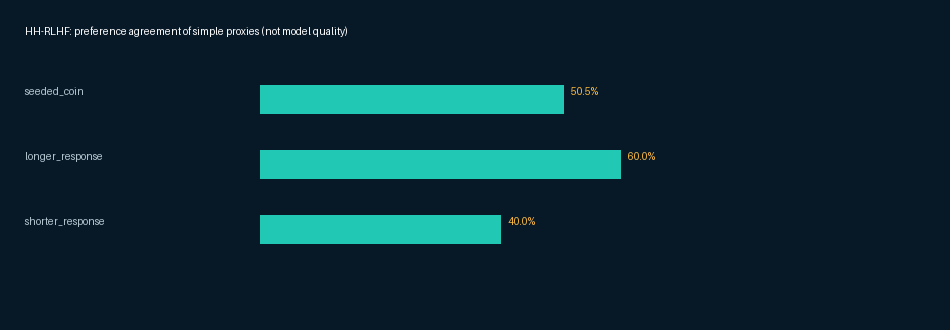

# HH-RLHF public preference study

A real public-data addition to the LLM evaluation project. It compares simple answer-length proxies with **original published human preferences**—not personally annotated labels or newly generated model responses.

## Source and attribution
Anthropic, *Training a Helpful and Harmless Assistant with Reinforcement Learning from Human Feedback* (2022): https://arxiv.org/abs/2204.05862

Official repository: https://github.com/anthropics/hh-rlhf
Dataset card: https://huggingface.co/datasets/Anthropic/hh-rlhf
Pinned revision: `c72f5cee8eb7b4d2ea5617657f4430d5e333af07`.
Input: `helpful-base/test.jsonl.gz`, SHA-256 `8be3fc1a13b27901631696f2be6f184c799f1baeaf145f53ac5db24960adc37b`.

The repository and dataset card specify MIT licensing. Original copyright/permission notice is retained in [`source/UPSTREAM_LICENSE.txt`](source/UPSTREAM_LICENSE.txt); preserve it when redistributing the derived sample. Original README and warnings are retained. No Anthropic affiliation or endorsement is implied. The source warns of potentially offensive material and is intended for preference/research analysis, not supervised fine-tuning of dialogue agents.

## What is actually included
- 200 paired examples / 400 original candidate answers.
- Original context and published chosen/rejected preference, converted to alternating A/B display order.
- Source revision and original JSONL line ID on every row.
- Input hashes and a hash of the immutable derived sample.
- Actual baseline metrics, topic breakdown, tie/coverage accounting, chart, failure queue and blank human-review forms.
- Executable ingestion/reanalysis and tests.

## Selection and changes
The official helpful-base test contains 2,354 records. Predeclared lexical/topic/context/size rules retained 304 eligible records; deterministic SHA ordering selects 200. The sample emphasizes computing, science and everyday practical tasks. Broad risky-content and email-word filters reduce exposure, but **are not human safety certification**. Selection rules and excluded counts are reported, not hidden. Display order changes; original answers and source preferences are not rewritten. This is a curated sample, not a representative evaluation of the full dataset.

## Actual finding
The longer-answer proxy agrees with the published preference on **117/195 non-tied pairs (60%)**, with five ties and 97.5% coverage. Over all 200 pairs, counting ties as no agreement, agreement is **58.5%**. A deterministic coin baseline is **50.5%**. This illustrates why surface-level proxies cannot replace a quality rubric; it is not an impressive model score or personal evaluation accuracy.

## Reproduce
```bash
python run_experiment.py
python -m unittest discover -s tests -v
```
The hash-verified selected sample is bundled, so reanalysis works offline. To independently reconstruct the sample from original source:
```bash
python run_experiment.py --download
```
Original compressed content goes into `data/cache/` and is excluded from the public package. No model API is required; charting uses Pillow already listed in root requirements.

## Reviewer workflow
Use the existing project rubric to assess accuracy, relevance, completeness and instruction following. Use the shared conversation context; source preference may depend on considerations beyond factual correctness. Record a reason when disagreeing with a preference. `results/human_review_forms.csv` is blank by design, and no completed personal review is claimed. Published human preference is subjective and is not factual-correctness gold.

## Evidence
- [Actual report](results/REPORT.md)
- [Metric values and topic counts](results/metrics.json)
- [Proxy failure queue](results/length_proxy_failure_queue.csv)
- [Review forms](results/human_review_forms.csv)
- [Source metadata](source/source-manifest.json)
- [Sample hash/selection ledger](source/sample-manifest.json)



## Limitations
One curated subset from an older public dataset, not a current production evaluation. No newly generated model comparison, personally written annotations, model safety certification, or employment evidence. Topic imbalance and lexical filtering introduce sampling bias. The findings concern preference-proxy limitations only. Implementation and documentation are AI-assisted.
