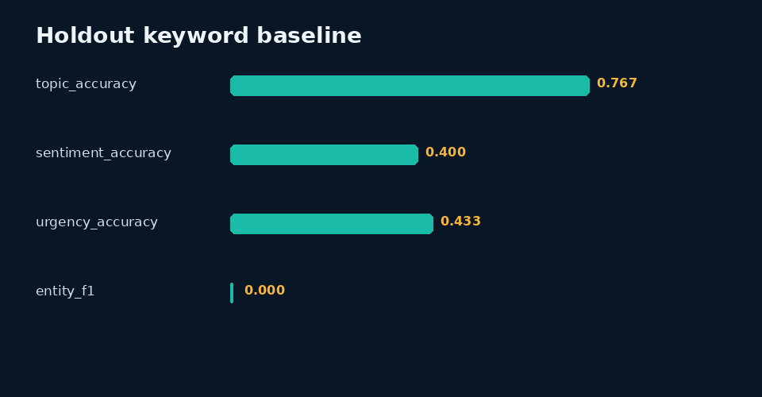

# Data Annotation and Quality Checks

> Independent portfolio practice by Sinshad PS. AI assistance was used during development. See the data card for exactly which records are synthetic.

## Why I made it

This project is about the unglamorous part of annotation: checking whether labels follow the rules, finding inconsistent cases, and making it clear what needs a second look. The starter examples and their provisional labels are synthetic. The BANKING77 experiment in this folder is a separate public-data study and is clearly documented on its own page.

## Dataset
See [`data/DATA_CARD.md`](data/DATA_CARD.md). All records are UTF-8 and available as JSONL and CSV.

## Evaluation framework
Frozen keyword dictionaries predict topic, sentiment, and urgency without reading reference labels. Regex extracts only high-confidence order/date entities. The first 70 IDs are calibration and final 30 are holdout.

## Scoring
Accuracy and macro-F1 are computed separately per task. Entity precision/recall/F1 requires exact start, end, and label match.

## Tools
Python standard library and Pillow. Inputs and outputs remain local; no network service is required.

## Implementation
- `src/analyze.py` runs this project independently.
- Root `analysis.py --project annotation` contains reusable metric and plotting logic.
- `notebooks/analysis.ipynb` contains executable code and captured output from the real metrics file.
- `results/review_queue.csv` makes disagreements, failures, escalations, or abstentions visible.
- `qa/worked-cases.md` connects evidence, rubric, QC, and decisions.

## Results
**Holdout topic accuracy: 76.7%**

The complete machine-readable output is [`results/metrics.json`](results/metrics.json), with interpretation in [`results/analysis.md`](results/analysis.md).



## What the result means

The 76.7% topic accuracy is measured on this small synthetic holdout only. Sentiment and urgency perform much worse, and entity-span F1 is zero on the holdout. The simulated second-label exercise is not human inter-annotator agreement.

## Limitations
Keywords are brittle and entity coverage is intentionally narrow. The controlled second-label corruption is SIMULATION NOT HUMAN and cannot establish annotator agreement.

## Future work
Run blinded qualified human review, adjudicate disagreements, document reviewer eligibility, test robustness under distribution shift, and revise rules only on calibration data before re-evaluating holdout data.

## Reproduction
From repository root:

`python analysis.py --project annotation`

or:

`python 02-AI-Data-Annotation/src/analyze.py`

Run validation with:

`python -m unittest discover -s tests`

Deterministic seed: `20261008`. Build date: 2026-10-09.

## Concrete findings

On the 30-record held-out partition, the frozen keyword baseline achieves topic accuracy 76.7%, sentiment accuracy 40.0%, and urgency accuracy 43.3%. This uneven performance shows why annotation requires meaning-level review rather than keyword matching.

Exact entity-span F1 is 0.000 on holdout. The extractor only recognizes limited order/date formats, not PRODUCT or ORG names; unsupported entity classes are not silently excluded from the denominator. The weak result is intentional evidence of baseline scope, not an annotation-quality claim.

29 records enter the structural/ambiguity review queue, and 2 records have span warnings. The simulated second-label exercise injects 13 known topic corruptions; its agreement statistic is a simulation, not human inter-annotator agreement. Calibration/holdout is a fixed order split, not random population sampling; no dictionaries were tuned on held-out labels during this run.

See [findings](results/findings.md) and the raw review queue.

<!-- BANKING77:START -->
## Completed real-data experiment: BANKING77

The six original projects remain **synthetic baselines**. An additional real public-data experiment now evaluates a classifier on **10,003 official training queries / 3,080 test queries / 77 intents**. Original annotations are attributed to Casanueva et al. / PolyAI under CC BY 4.0; no personal annotation claim is made.

| Official test result | Value |
|---|---:|
| Multinomial Naive Bayes accuracy | 85.88% (2645/3080) |
| Macro-F1 (77 intents) | 0.8579 |
| Top-3 accuracy | 95.16% |
| Majority baseline accuracy | 1.30% |
| Accuracy after excluding 7 train-overlap test queries | 85.84% |
| Pending automated review queue | 535 cases |

Alpha=0.1 was selected using training-derived validation, not the test set. These are measured **classifier results against published labels**, not the portfolio owner's personal accuracy. All human-review fields remain blank.

- [Experiment and reproduction](experiments/banking77/README.md)
- [Actual results, limitations and examples](experiments/banking77/results/REPORT.md)
- [Source hashes and license](experiments/banking77/source/source-manifest.json)
- [10 experiment tests](experiments/banking77/tests/test_banking77.py)

```bash
python experiments/banking77/run_experiment.py
python -m unittest discover -s experiments/banking77/tests -v
```

<!-- BANKING77:END -->
