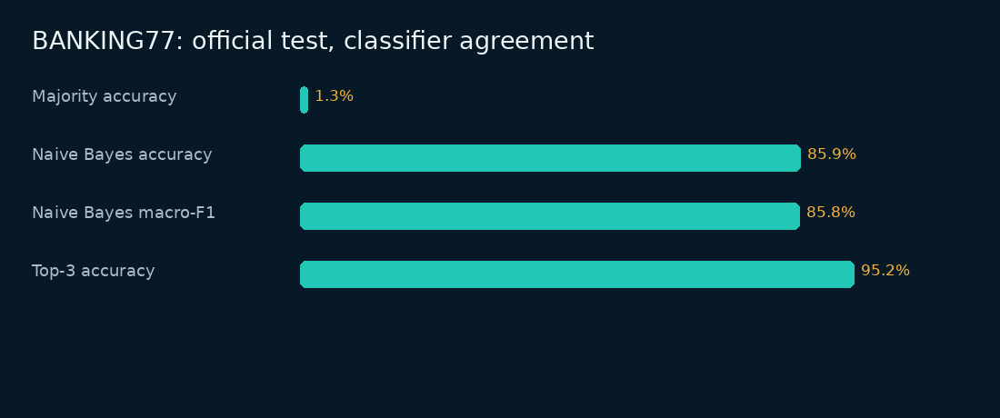

# BANKING77 — real public-data intent classification & label QA

A separate real-data experiment within Sinshad PS's AI-assisted evaluation portfolio. The existing six-label synthetic annotation benchmark is preserved separately, not replaced or relabeled.

## Objective
Evaluate a transparent intent-classification baseline against published labels, audit source integrity and split leakage, and produce a reviewable error queue. This demonstrates a data/evaluation pipeline; it does **not** claim that the portfolio owner collected the queries, annotated them, or achieved a personal annotator-quality score.

## Verified source and license
- Original repository: https://github.com/PolyAI-LDN/task-specific-datasets
- Pinned revision: `57ec275d8078af65b7731c2a98be812d844a6d6b`
- Dataset files: `banking_data/train.csv`, `banking_data/test.csv`, `banking_data/categories.json`.
- The upstream README explicitly says its shared datasets are governed by the repository LICENSE, which is **Creative Commons Attribution 4.0 International**. This is not merely an assumption about a code license.
- Hugging Face dataset card corroborates CC BY 4.0: https://huggingface.co/datasets/PolyAI/banking77
- Full license: [`source/BANKING77_LICENSE.txt`](source/BANKING77_LICENSE.txt). License URL: https://creativecommons.org/licenses/by/4.0/
- Source documentation is retained in [`source/UPSTREAM_README.md`](source/UPSTREAM_README.md).
- Every source file is pinned by SHA-256 in [`source/source-manifest.json`](source/source-manifest.json).

## Attribution and changes
**BANKING77 by Iñigo Casanueva, Tadas Temcinas, Daniela Gerz, Matthew Henderson and Ivan Vulić / PolyAI.** Cite *Efficient Intent Detection with Dual Sentence Encoders*, Proceedings of the 2nd Workshop on NLP for ConvAI, ACL 2020: https://arxiv.org/abs/2003.04807

Original queries and categories are not rewritten. Derived JSONL adds stable IDs, split and provenance fields. Feature extraction normalizes Unicode/case and produces word unigrams/bigrams. Results, predictions and review queues are newly generated. Source labels remain published annotations, not personally reannotated labels. No affiliation, endorsement or production-client relationship is implied. Upstream as-is warranty disclaimers remain applicable.

## Dataset
- 10,003 official training queries.
- 3,080 official test queries.
- 77 fine-grained English banking intents, retaining the original category spelling and capitalization.
- No sentiment, Malayalam, entity-span or safety labels have been fabricated for this dataset.
- `source_record_id` identifies a parsed CSV record, not an assumed physical line number.

## Methodology
1. Verify the five original files against pinned byte counts and hashes.
2. Validate text/labels and official counts; reject invalid inputs rather than silently repairing them.
3. Audit within-split duplicates, normalized train/test overlap and conflicting reference labels.
4. Split official training into approximately 85% fit / 15% development data using deterministic per-class **normalized-text groups**. Identical normalized text stays on one side.
5. Train word-unigram + word-bigram multinomial Naive Bayes with additive smoothing values `0.1`, `0.5`, `1.0`. Features and vocabulary come from fit only during selection. Keep negation and stop words.
6. Select alpha by development macro-F1, then development accuracy, then smaller alpha. No test labels are used to choose parameters.
7. Refit on all official training data, evaluate once on the official test set, and compare with a training-frequency majority classifier.
8. Report accuracy, macro-F1, top-3 accuracy, all per-intent scores, a 77×77 confusion matrix and error examples.
9. Report a secondary test score excluding exact normalized-text overlap with training; do not silently alter the official split.
10. Queue published-label disagreements and confidence below a **predeclared 0.8 threshold**. Human review fields stay blank. Confidence is uncalibrated, so neither the threshold nor high-confidence predictions guarantee correctness.

## Metric definitions
- Accuracy = correct predictions / evaluated queries.
- Per-intent precision = TP/(TP+FP); recall = TP/(TP+FN); F1 = harmonic mean.
- Macro-F1 = unweighted mean of all 77 per-intent F1 scores; undefined class rates are zero.
- Top-3 accuracy = fraction whose published intent appears in the three highest-scoring classes.
- Naive Bayes log score = log class prior + sum(feature count × log smoothed feature probability). Softmax of log scores supplies an explicitly uncalibrated confidence.
- Coverage = retained predictions / all test queries; retained accuracy is conditional on the threshold.

## Reproduce
From this experiment directory:

```bash
python ingest.py
python run_experiment.py
python -m unittest discover -s tests -v
```

Raw files are included under their attributed CC BY 4.0 license, so this runs offline. To retrieve missing original files from the pinned source:

```bash
python ingest.py --download
python run_experiment.py --download
```

From portfolio root:

```bash
python 02-AI-Data-Annotation/experiments/banking77/run_experiment.py
python -m unittest discover -s 02-AI-Data-Annotation/experiments/banking77/tests -v
```

The classifier uses the Python standard library; plots use the portfolio's existing Pillow dependency. No paid API, pretrained model download or large ML dependency is required.

## Actual results and artifacts
- [Measured report](results/REPORT.md)
- [Metrics](results/metrics.json) and [frozen configuration](results/config.json)
- [Training-only alpha selection](results/validation-selection.json)
- [Source QA](results/source-qa.json) and [label-conflict flags](results/label-conflicts.json)
- [Official-test predictions](results/test_predictions.csv)
- [Per-intent scores](results/per_intent.csv) and [confusion matrix](results/confusion_matrix.csv)
- [Top confusions](results/top_confusions.csv), [review queue](results/review_queue.csv), [confidence/coverage sensitivity](results/confidence_coverage.csv)
- [Executed notebook](notebooks/analysis.ipynb)
- [Small attributed training sample](data/derived/training_sample_77.csv)



## Limitations and future work
This is one established public English banking benchmark. It does not measure personal annotation accuracy, financial expertise, deployment safety, multilingual quality or production generalization. Published references can be ambiguous. The baseline is lexical; confidence is not calibrated. Human adjudication, new-domain evaluation and model improvements require separate experiments. Do not revise the model repeatedly against the same official test set and call it unseen validation.

## Claim you may accurately use
> My AI-assisted portfolio includes a reproducible BANKING77 experiment using the official public dataset, pinned source hashes, training-only parameter selection, classifier metrics and an unfilled error-adjudication queue. Original labels are credited to the dataset authors.
