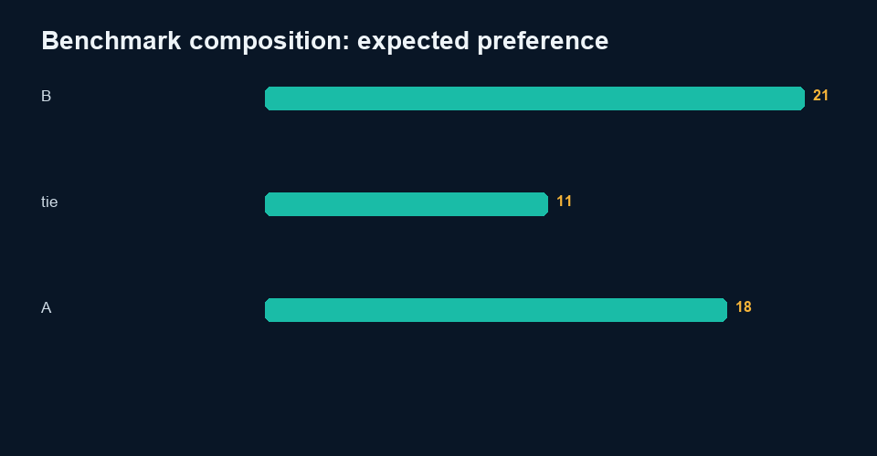

# Malayalam–English Text QA Practice

> Independent portfolio practice by Sinshad PS. AI assistance was used during development. See the data card for exactly which records are synthetic.

## Why I made it

I used this project to explore basic checks that can flag suspicious Malayalam text records, such as script coverage, Unicode normalization and digit changes. These checks can catch formatting problems, but they cannot tell me on their own whether a translation is natural or correct. The examples and provisional labels are synthetic, and proper language-quality conclusions still need a qualified human reviewer.

## Dataset
See [`data/DATA_CARD.md`](data/DATA_CARD.md). All records are UTF-8 and available as JSONL and CSV.

## Evaluation framework
Summarize benchmark preference/error composition, then run NFC, Malayalam-codepoint ratio, and digit-preservation flag checks.

## Scoring
Composition error rate counts supplied synthetic error tags. Automatic QC flags are integrity indicators, not linguistic scores.

## Tools
Python standard library and Pillow. Inputs and outputs remain local; no network service is required.

## Implementation
- `src/analyze.py` runs this project independently.
- Root `analysis.py --project multilingual` contains reusable metric and plotting logic.
- `notebooks/analysis.ipynb` contains executable code and captured output from the real metrics file.
- `results/review_queue.csv` makes disagreements, failures, escalations, or abstentions visible.
- `qa/worked-cases.md` connects evidence, rubric, QC, and decisions.

## Results
**Automatic QC flags: 5 of 100**

The complete machine-readable output is [`results/metrics.json`](results/metrics.json), with interpretation in [`results/analysis.md`](results/analysis.md).

## What the result means

Five of 100 candidates trigger automatic checks. These are integrity flags, not a linguistic quality score. Semantic accuracy, grammar, naturalness, and cultural nuance still require a qualified Malayalam reviewer; that review has not yet been completed.

## Limitations
Malayalam native human review is pending. Digit translation may legitimately use Malayalam digits or spelled numbers; flags are never definitive language correctness.

## Future work
Run blinded qualified human review, adjudicate disagreements, document reviewer eligibility, test robustness under distribution shift, and revise rules only on calibration data before re-evaluating holdout data.

## Reproduction
From repository root:

`python analysis.py --project multilingual`

or:

`python 03-Multilingual-AI-Evaluation/src/analyze.py`

Run validation with:

`python -m unittest discover -s tests`

Deterministic seed: `20261008`. Build date: 2026-10-09.

## Concrete findings

The benchmark contains 50 English prompts and 100 Malayalam candidate translations. Automatic integrity checks flag 5 candidates. Passing these checks cannot establish semantic fidelity, grammatical correctness or cultural appropriateness.

Error categories describe synthetic benchmark construction. The category 'none' is retained in the composition table but is excluded from per-domain error-rate numerators. Digit mismatches are review flags because Malayalam may express a number in words. Native-speaker judgments, rationale edits and adjudication remain pending; blank reviewer forms are supplied rather than fabricated ratings.

See [findings](results/findings.md) and the raw review queue.
