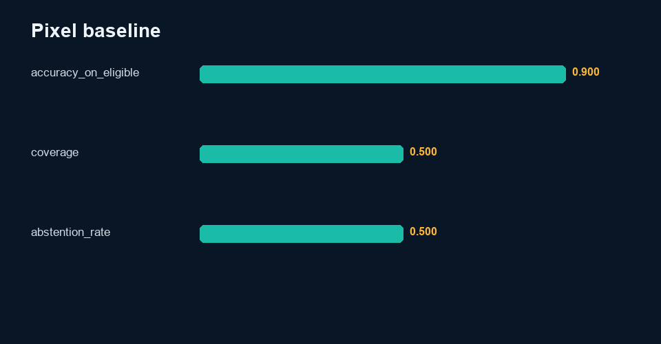

# Visual Question Checks on Constructed Scenes

> Independent portfolio practice by Sinshad PS. AI assistance was used during development. See the data card for exactly which records are synthetic.

## Why I made it

For this exercise, I generated simple geometric scenes and tested a small baseline on questions that can be answered from the scene’s construction details. It is useful for practising test cases and abstention, but it is not evidence that I evaluated a production vision model or can handle every kind of natural photograph. The scenes and labels are constructed for this project.

## Dataset
See [`data/DATA_CARD.md`](data/DATA_CARD.md). All records are UTF-8 and available as JSONL and CSV.

## Evaluation framework
Render deterministic scenes, derive ground truth from geometry, create controlled correct/faulty answers, and evaluate eligible tasks with RGB connected-component or bar-pixel scanning.

## Scoring
Pixel accuracy = correct eligible predictions / eligible predictions. Coverage = eligible predictions / all scenes; unsupported question types abstain.

## Tools
Python standard library and Pillow. Inputs and outputs remain local; no network service is required.

## Implementation
- `src/analyze.py` runs this project independently.
- Root `analysis.py --project multimodal` contains reusable metric and plotting logic.
- `notebooks/analysis.ipynb` contains executable code and captured output from the real metrics file.
- `results/review_queue.csv` makes disagreements, failures, escalations, or abstentions visible.
- `qa/worked-cases.md` connects evidence, rubric, QC, and decisions.

## Results
**Pixel baseline: 90.0% on 50.0% coverage**

The complete machine-readable output is [`results/metrics.json`](results/metrics.json), with interpretation in [`results/analysis.md`](results/analysis.md).

## What the result means

The baseline gets 54 of 60 eligible questions right (90%) and covers 50% of all questions. This is a controlled image-processing exercise on generated graphics—not an evaluation of a vision-language model or real-world photographs.

## Limitations
These are artificial images, not natural photos. Metadata is an oracle for data construction only and is not read by the pixel baseline. This is not a VLM evaluation.

## Future work
Run blinded qualified human review, adjudicate disagreements, document reviewer eligibility, test robustness under distribution shift, and revise rules only on calibration data before re-evaluating holdout data.

## Reproduction
From repository root:

`python analysis.py --project multimodal`

or:

`python 04-Multimodal-AI-Evaluation/src/analyze.py`

Run validation with:

`python -m unittest discover -s tests`

Deterministic seed: `20261008`. Build date: 2026-10-09.

## Concrete findings

The visual dataset contains 120 unique rendered PNGs and 240 synthetic answer records. The actual RGB-pixel baseline correctly answers 54/60 eligible questions (90.0%), with 50.0% coverage and 60 abstentions.

The baseline reads image pixels for counts, color frequency and bar height. Ground truth is generated from rendering geometry; scene metadata is not used to predict answers. Abstentions cover spatial/absence/UI tasks unsupported by this baseline. Performance on simple colored components says nothing about photographs, real charts, OCR or a vision-language model. Six color-order failures in the eligible subset expose limitations of the leftmost tie heuristic on multi-row layouts.

See [findings](results/findings.md) and the raw review queue.
