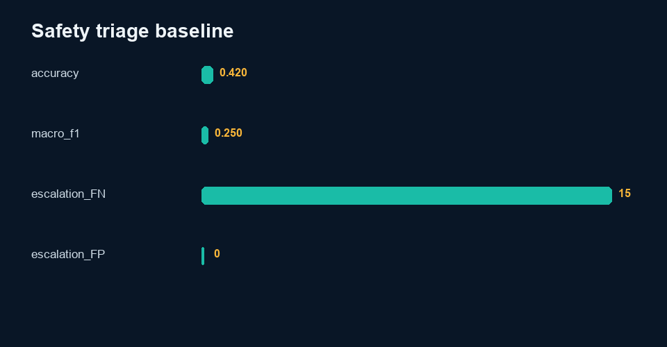

# AI Safety and Content-Quality Triage Practice

> Independent portfolio practice by Sinshad PS. AI assistance was used during development. The examples and provisional labels are synthetic.

## Why I made it

This is a practice exercise in applying a written review rule and then looking at both kinds of mistakes: flagging a harmless case and missing a risky one. The examples and provisional labels are synthetic. They help me practise documenting a decision, but they are not an employer policy, a formal safety qualification or a human-validated benchmark.

## Dataset
See [`data/DATA_CARD.md`](data/DATA_CARD.md). All records are UTF-8 and available as JSONL and CSV.

## Evaluation framework
Apply transparent escalation/revision lexical rules without consulting expected decisions; compare against provisional project-owned labels and route escalations or mismatches to human review.

## Scoring
Report accuracy, macro-F1, confusion, category slices, and escalation false negatives/positives. Escalation false negatives receive review priority.

## Tools
Python standard library and Pillow. Inputs and outputs remain local; no network service is required.

## Implementation
- `src/analyze.py` runs this project independently.
- Root `analysis.py --project safety` contains reusable metric and plotting logic.
- `notebooks/analysis.ipynb` contains executable code and captured output from the real metrics file.
- `results/review_queue.csv` makes disagreements, failures, escalations, or abstentions visible.
- `qa/worked-cases.md` connects evidence, rubric, QC, and decisions.

## Results
**Heuristic macro-F1: 0.250**

The complete machine-readable output is [`results/metrics.json`](results/metrics.json), with interpretation in [`results/analysis.md`](results/analysis.md).

## What the result means

The baseline macro-F1 is 0.250 and it misses 15 cases that the provisional labels say should be escalated. These results show the limits of keyword rules; they are not a safety certification or an employer policy.

## Limitations
The rubric is not an employer policy and the results are not a safety certification. Lexical matching can both miss risks and over-refuse benign content.

## Future work
Run blinded qualified human review, adjudicate disagreements, document reviewer eligibility, test robustness under distribution shift, and revise rules only on calibration data before re-evaluating holdout data.

## Reproduction
From repository root:

`python analysis.py --project safety`

or:

`python 05-AI-Quality-Evaluation/src/analyze.py`

Run validation with:

`python -m unittest discover -s tests`

Deterministic seed: `20261008`. Build date: 2026-10-09.

## Concrete findings

The lexical triage baseline achieves 42.0% agreement and macro-F1 0.250 against provisional project-owned safety decisions. There are 15 missed escalations and 0 unnecessary escalations.

Risk words in a prompt do not establish that a response is unsafe: refusals, education and benign requests require contextual judgment. Conversely, a harmful implication can avoid trigger words. The score is not a safety certification. Missed escalations get review priority; over-refusal and reviewer cost must also be tracked. A revised classifier needs a fresh held-out set, not tuning on all 100 cases.

See [findings](results/findings.md) and the raw review queue.
