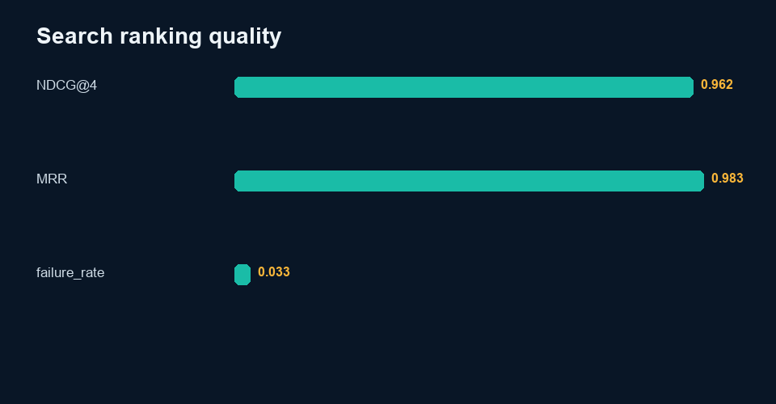

# Search Relevance Practice

> Independent portfolio practice by Sinshad PS. AI assistance was used during development. See the data card for exactly which records are synthetic.

## Why I made it

I built a basic lexical ranker over a fictional set of search results so I could work with ranking metrics and inspect why keyword overlap sometimes puts the wrong result near the top. The corpus and relevance labels are synthetic. This is a learning exercise, not a live search-engine evaluation or evidence of results on a commercial search product.

## Dataset
See [`data/DATA_CARD.md`](data/DATA_CARD.md). All records are UTF-8 and available as JSONL and CSV.

## Evaluation framework
Rank each query’s four fictional results by TF-IDF-style lexical overlap over query, title, and snippet without using relevance labels.

## Scoring
NDCG@4 uses gain 2^relevance−1 and log2 rank discount. MRR uses the first result with relevance ≥2.

## Tools
Python standard library and Pillow. Inputs and outputs remain local; no network service is required.

## Implementation
- `src/analyze.py` runs this project independently.
- Root `analysis.py --project search` contains reusable metric and plotting logic.
- `notebooks/analysis.ipynb` contains executable code and captured output from the real metrics file.
- `results/review_queue.csv` makes disagreements, failures, escalations, or abstentions visible.
- `qa/worked-cases.md` connects evidence, rubric, QC, and decisions.

## Results
**NDCG@4: 0.962; MRR: 0.983**

The complete machine-readable output is [`results/metrics.json`](results/metrics.json), with interpretation in [`results/analysis.md`](results/analysis.md).

## What the result means

The reported NDCG@4 is 0.962 and MRR is 0.983 on 30 synthetic queries. The scores are likely optimistic because the snippets often repeat query terms. They do not measure Google or another live search engine.

## Limitations
Judgments describe a fictional corpus, not live search. Lexical matching misses semantic, domain, locale, freshness, and local-intent nuance.

## Future work
Run blinded qualified human review, adjudicate disagreements, document reviewer eligibility, test robustness under distribution shift, and revise rules only on calibration data before re-evaluating holdout data.

## Reproduction
From repository root:

`python analysis.py --project search`

or:

`python 06-Search-Relevance/src/analyze.py`

Run validation with:

`python -m unittest discover -s tests`

Deterministic seed: `20261008`. Build date: 2026-10-09.

## Concrete findings

Across 30 fictional query sets (120 judged results), lexical ranking achieves NDCG@4 0.962 and MRR 0.983. The review queue contains 1 cases below NDCG 0.8.

These scores are likely optimistic because the synthetic snippets often repeat query terms and each query has only four candidate results. They are not search-engine performance. Evaluate synonym-heavy queries, ambiguous intent, misleading keyword overlap, locale mismatch and stale-but-on-topic results on a new collection before making stronger claims. Intended local coverage must be checked from the actual intent counts, not assumed from the generation brief.

See [findings](results/findings.md) and the raw review queue.
